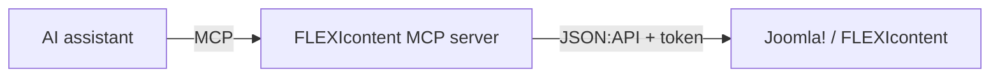

# MCP server

The Model Context Protocol (MCP) server lets an AI assistant operate a FLEXIcontent site. The assistant does not talk to Joomla! directly:



The server is a small Python program shipped with FLEXIcontent. It adds the Joomla! token, calls the [JSON:API](./webservices.md), and returns a readable result. No core file needs to be changed.

## Available tools

| Need | Tool |
| --- | --- |
| Search items, filter by custom field | `flexi_search_items` |
| Read an item and its custom fields | `flexi_get_item` |
| List categories, types, fields and tags | `flexi_list_taxonomies`, `flexi_get_taxonomy` |
| Discover valid ids before writing | `flexi_describe` |
| Create or update content | `flexi_create_item`, `flexi_update_item` |
| Delete content (confirmation required) | `flexi_delete_item` |
| Create/update a category, type, field or tag | `flexi_create_taxonomy`, `flexi_update_taxonomy` |
| Import an image or document | `flexi_upload_file` |

Two transports are available:

- **stdio** (default): the AI client starts the server locally. No network port to open.
- **Streamable HTTP**: the server runs continuously on `https://your-domain/mcp`, useful for several clients or remote use.

## 1. Prepare Joomla!

Follow the [Web Services setup](./webservices.md): enable the token plugins and the FLEXIcontent Web Services plugin, create a dedicated account with minimum rights, grant `core.login.api`, and generate a token.

## 2. Install the server

Python 3.10 or newer is required. From the `mcp/` folder shipped with FLEXIcontent:

```bash
cd mcp
python3 -m venv .venv
.venv/bin/python -m pip install -e .
.venv/bin/flexicontent-mcp --help
```

## 3. Configure a profile

All sensitive configuration stays on the server side. Create `~/.config/flexicontent-mcp/config.toml`:

```bash
mkdir -p ~/.config/flexicontent-mcp
```

```toml
default_profile = "production"

[profiles.production]
base_url = "https://example.com/api/index.php/v1/flexicontent"
token_file = "token.txt"
read_only = true
```

`token.txt` is looked up next to `config.toml`. Create it without leaving the token in your shell history:

```bash
read -rs -p "Joomla API token: " FLEXI_TOKEN; echo
printf '%s' "$FLEXI_TOKEN" > ~/.config/flexicontent-mcp/token.txt
chmod 600 ~/.config/flexicontent-mcp/token.txt
unset FLEXI_TOKEN
```

Alternatives: `token_env = "FLEXI_API_TOKEN"` or `token_command = "security find-generic-password -s flexicontent -w"` (macOS keychain).

Priority is always: **CLI options > environment variables > TOML profile > built-in defaults**.

Start with `read_only = true`: all write tools are disabled. Check that the assistant can read your content, then set `read_only = false` (or pass `--no-read-only`) when you want to allow changes. Deletions still require `confirm: true`.

Test the profile with:

```bash
.venv/bin/flexicontent-mcp --profile production
```

The server waits for instructions on standard input: this is expected.

## 4. Connect an AI client

Replace `/path/to/mcp/` with the real path to the `mcp/` folder. The token never appears in these files.

### OpenCode

`opencode.json`:

```json
{
  "$schema": "https://opencode.ai/config.json",
  "mcp": {
    "servers": {
      "flexicontent": {
        "type": "local",
        "command": [
          "/path/to/mcp/.venv/bin/flexicontent-mcp",
          "--profile", "production"
        ]
      }
    }
  }
}
```

Check with `opencode mcp list`; you should see `✓ flexicontent  connected`.

### Claude Desktop

`claude_desktop_config.json`:

```json
{
  "mcpServers": {
    "flexicontent": {
      "command": "/path/to/mcp/.venv/bin/flexicontent-mcp",
      "args": ["--profile", "production"]
    }
  }
}
```

Restart Claude Desktop after editing the file.

### Claude Code

```bash
claude mcp add --transport stdio flexicontent -- \
  /path/to/mcp/.venv/bin/flexicontent-mcp --profile production
```

Then run `claude mcp list` and `/mcp` in the session.

### Cursor

`~/.cursor/mcp.json` or the project `.cursor/mcp.json`:

```json
{
  "mcpServers": {
    "flexicontent": {
      "type": "stdio",
      "command": "/path/to/mcp/.venv/bin/flexicontent-mcp",
      "args": ["--profile", "production"]
    }
  }
}
```

### VS Code / GitHub Copilot

`.mcp.json` at the workspace root:

```json
{
  "mcpServers": {
    "flexicontent": {
      "type": "stdio",
      "command": "/path/to/mcp/.venv/bin/flexicontent-mcp",
      "args": ["--profile", "production"],
      "tools": ["*"]
    }
  }
}
```

## 5. First conversations

Check the connection first:

> Use `flexi_describe` to tell me which types and categories are available on the site.

Then make concrete requests, for example:

> Find items published in 2025 and give me their title, id and category.

> Show me item 151 with all its custom fields.

> Create a draft titled "Test" in the right category, but do not publish it.

Before any write, the assistant should call `flexi_describe` to learn the valid type, field and category ids. This avoids most `422` errors.

To delete an item, ask for the deletion, then confirm explicitly when the server asks.

## 6. Shared HTTP transport

If several clients need to connect, run the server in HTTP mode:

```bash
.venv/bin/flexicontent-mcp \
  --profile production \
  --transport streamable-http \
  --host 127.0.0.1 \
  --port 8000 \
  --allowed-host mcp.example.com:*
```

The endpoint is `http://127.0.0.1:8000/mcp`. Always put an authenticated HTTPS reverse proxy in front of the service: the Joomla! token stays on the server, but access to the MCP server must be protected. `--allowed-host` is required behind a proxy, otherwise the SDK DNS-rebinding protection rejects requests.

For OpenCode:

```json
{
  "mcp": {
    "servers": {
      "flexicontent": {
        "type": "remote",
        "url": "https://mcp.example.com/mcp",
        "oauth": false
      }
    }
  }
}
```

`oauth: false` matters: Joomla! authentication is already handled by the MCP server.

## 7. Troubleshooting

| Symptom | Likely cause | Fix |
| --- | --- | --- |
| `✓ flexicontent connected` missing | Wrong venv path or profile not found | Check the command and `--profile`, then restart the client |
| `401` | Invalid, disabled or regenerated token | Copy the new token and update `token.txt` |
| `403` | Insufficient ACL | Check the Joomla! account rights and `core.login.api` |
| `404` | Wrong base URL or id | The URL must end in `/v1/flexicontent`, with no trailing slash |
| `422` | Invalid field or type | Call `flexi_describe` before writing |
| Writes are disabled | Profile is read-only | Remove `read_only = true` or pass `--no-read-only` |
| TLS error on a dev site | Self-signed certificate | Add `--no-verify-ssl` in development only |
| Invalid Host header | Proxy in front of localhost | Add `--allowed-host your-domain:*` |
| Client sees no tools | Bad stdio configuration | Use the absolute path to `.venv/bin/flexicontent-mcp` |

For finer diagnostics, start the server with `--log-level DEBUG`; logs go to stderr so they do not pollute the MCP conversation.

## Best practices

- Use a dedicated Joomla! account with the minimum permissions.
- Store the token in a `0600` file, an environment variable or a keychain — never in an AI client config file.
- Start in read-only mode, then enable writes.
- Always call `flexi_describe` before creating or updating.
- Use HTTPS in production, keep Basic Auth disabled, revoke the token if it leaks.
- Over HTTP, never expose the server port without an authenticated proxy.

Official tutorial: [How to use Flexicontent MCP](https://www.flexicontent.org/documentation/tutorials-english/70-developer-api-field-plugins/832-how-to-use-flexicontent-mcp.html).
