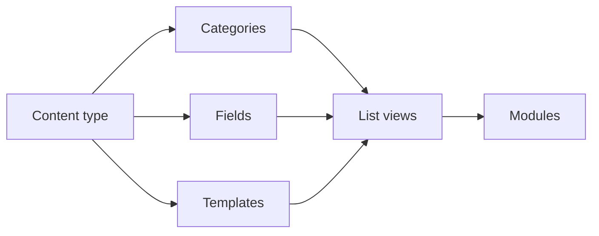

# Introduction to FLEXIcontent

**FLEXIcontent** is a Joomla! component that turns the native article management into a full **CCK** (Content Construction Kit). It does not replace `com_content`, `com_categories` or `com_tags`: it builds on them to add custom content types, fields, access rules, filters and display templates.

This documentation is maintained in English and French, and targets the **FLEXIcontent 5.x** branch, compatible with **Joomla! 4.x, 5.x and 6.x**.

## What FLEXIcontent adds

- An unlimited number of **content types**: article, event, product sheet, directory, portfolio, documentation, etc.
- Reusable **custom fields**, with single or multiple values, ordering, ACL and versioning.
- Nested **categories** and assignment of one item to several categories.
- List views with **search and faceted filtering** on fields.
- A publication **workflow** and fine-grained permissions through Joomla! ACL.
- Custom **PHP/CSS templates** for item and category views.
- Bundled **modules**: universal content, filters, map, tag cloud, categories, search.
- **CSV import and export** of content.

## Who is it for?

- **Site owners and editors** who need structured content without writing code.
- **Integrators and web designers** who build custom layouts with templates and fields.
- **Developers** who extend FLEXIcontent with their own fields, plugins or scripts through its API.

## How it fits together

## Where to start?

- [Install FLEXIcontent](./demarrage/installation.md)
- [Follow the getting started guide](./demarrage/premiers-pas.md)
- [Explore the key concepts](./concepts/types-de-contenu.md)

:::note
This documentation is an independent community project. For official information, visit the [FLEXIcontent website](https://www.flexicontent.org/) and its [official documentation](https://flexicontent.org/_documentation_notes/).
:::
