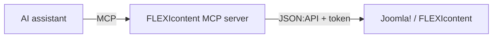

# Serveur MCP

Le protocole MCP (Model Context Protocol) permet à un assistant IA de piloter un site FLEXIcontent. L’assistant ne parle pas directement à Joomla! :



Le serveur est un petit programme Python fourni avec FLEXIcontent. Il ajoute le jeton Joomla!, appelle la [JSON:API](./webservices.md) et renvoie un résultat lisible. Aucun fichier du cœur n’est à modifier.

## Outils disponibles

| Besoin | Outil |
| --- | --- |
| Rechercher des contenus, filtrer par champ personnalisé | `flexi_search_items` |
| Lire un contenu et ses champs personnalisés | `flexi_get_item` |
| Lister les catégories, types, champs et étiquettes | `flexi_list_taxonomies`, `flexi_get_taxonomy` |
| Découvrir les identifiants valides avant d’écrire | `flexi_describe` |
| Créer ou modifier du contenu | `flexi_create_item`, `flexi_update_item` |
| Supprimer du contenu (confirmation requise) | `flexi_delete_item` |
| Créer/modifier une catégorie, un type, un champ ou une étiquette | `flexi_create_taxonomy`, `flexi_update_taxonomy` |
| Importer une image ou un document | `flexi_upload_file` |

Deux transports sont disponibles :

- **stdio** (par défaut) : le client IA démarre le serveur localement. Aucun port réseau à ouvrir.
- **Streamable HTTP** : le serveur fonctionne en continu sur `https://your-domain/mcp`, utile pour plusieurs clients ou un usage distant.

## 1. Préparer Joomla!

Suivez la [configuration des Services Web](./webservices.md) : activez les plugins de jeton et le plugin FLEXIcontent Web Services, créez un compte dédié avec les droits minimaux, accordez `core.login.api` et générez un jeton.

## 2. Installer le serveur

Python 3.10 ou plus récent est requis. Depuis le dossier `mcp/` fourni avec FLEXIcontent :

```bash
cd mcp
python3 -m venv .venv
.venv/bin/python -m pip install -e .
.venv/bin/flexicontent-mcp --help
```

## 3. Configurer un profil

Toute la configuration sensible reste **côté serveur**. Créez `~/.config/flexicontent-mcp/config.toml` :

```bash
mkdir -p ~/.config/flexicontent-mcp
```

```toml
default_profile = "production"

[profiles.production]
base_url = "https://example.com/api/index.php/v1/flexicontent"
token_file = "token.txt"
read_only = true
```

`token.txt` est recherché **à côté de `config.toml`**. Créez-le sans laisser le jeton dans l’historique du shell :

```bash
read -rs -p "Joomla API token: " FLEXI_TOKEN; echo
printf '%s' "$FLEXI_TOKEN" > ~/.config/flexicontent-mcp/token.txt
chmod 600 ~/.config/flexicontent-mcp/token.txt
unset FLEXI_TOKEN
```

Autres options selon votre gestionnaire de secrets : `token_env = "FLEXI_API_TOKEN"` ou `token_command = "security find-generic-password -s flexicontent -w"` (trousseau macOS).

La priorité est toujours : **options CLI > variables d’environnement > profil TOML > valeurs par défaut intégrées**.

Commencez avec `read_only = true` : tous les outils d’écriture sont désactivés. Vérifiez que l’assistant peut lire vos contenus, puis passez à `read_only = false` (ou `--no-read-only`) lorsque vous souhaitez autoriser les modifications. Les suppressions nécessitent toujours `confirm: true`.

Testez le profil avec :

```bash
.venv/bin/flexicontent-mcp --profile production
```

Le serveur attend des instructions sur l’entrée standard : c’est normal.

## 4. Connecter un client IA

Remplacez `/path/to/mcp/` par le chemin réel du dossier `mcp/`. Le jeton n’apparaît jamais dans ces fichiers.

### OpenCode

`opencode.json` :

```json
{
  "$schema": "https://opencode.ai/config.json",
  "mcp": {
    "servers": {
      "flexicontent": {
        "type": "local",
        "command": [
          "/path/to/mcp/.venv/bin/flexicontent-mcp",
          "--profile", "production"
        ]
      }
    }
  }
}
```

Vérifiez avec `opencode mcp list` ; vous devriez voir `✓ flexicontent  connected`.

### Claude Desktop

`claude_desktop_config.json` :

```json
{
  "mcpServers": {
    "flexicontent": {
      "command": "/path/to/mcp/.venv/bin/flexicontent-mcp",
      "args": ["--profile", "production"]
    }
  }
}
```

Redémarrez Claude Desktop après modification du fichier.

### Claude Code

```bash
claude mcp add --transport stdio flexicontent -- \
  /path/to/mcp/.venv/bin/flexicontent-mcp --profile production
```

Lancez ensuite `claude mcp list` et `/mcp` dans la session.

### Cursor

`~/.cursor/mcp.json` ou `.cursor/mcp.json` du projet :

```json
{
  "mcpServers": {
    "flexicontent": {
      "type": "stdio",
      "command": "/path/to/mcp/.venv/bin/flexicontent-mcp",
      "args": ["--profile", "production"]
    }
  }
}
```

### VS Code / GitHub Copilot

`.mcp.json` à la racine de l’espace de travail :

```json
{
  "mcpServers": {
    "flexicontent": {
      "type": "stdio",
      "command": "/path/to/mcp/.venv/bin/flexicontent-mcp",
      "args": ["--profile", "production"],
      "tools": ["*"]
    }
  }
}
```

## 5. Premières conversations

Vérifiez d’abord la connexion :

> Utilise `flexi_describe` pour me dire quels types et quelles catégories sont disponibles sur le site.

Puis formulez des demandes concrètes, par exemple :

> Trouve les contenus publiés en 2025 et donne-moi leur titre, leur identifiant et leur catégorie.

> Montre-moi le contenu 151 avec tous ses champs personnalisés.

> Crée un brouillon intitulé « Test » dans la bonne catégorie, mais ne le publie pas.

Avant toute écriture, l’assistant doit appeler `flexi_describe` pour connaître les identifiants valides des types, champs et catégories. Cela évite la plupart des erreurs `422`.

Pour supprimer un contenu, demandez la suppression, puis confirmez explicitement avec `confirm: true` lorsque le serveur le demande.

## 6. Transport HTTP partagé

Si plusieurs clients doivent se connecter, lancez le serveur en mode HTTP :

```bash
.venv/bin/flexicontent-mcp \
  --profile production \
  --transport streamable-http \
  --host 127.0.0.1 \
  --port 8000 \
  --allowed-host mcp.example.com:*
```

Le point d’accès est `http://127.0.0.1:8000/mcp`. Placez toujours un **proxy inverse HTTPS authentifié** devant ce service : le jeton Joomla! reste sur le serveur, mais l’accès au serveur MCP doit être protégé. `--allowed-host` est obligatoire derrière un proxy, sinon la protection contre le DNS rebinding du SDK rejette les requêtes.

Pour OpenCode :

```json
{
  "mcp": {
    "servers": {
      "flexicontent": {
        "type": "remote",
        "url": "https://mcp.example.com/mcp",
        "oauth": false
      }
    }
  }
}
```

`oauth: false` est important : l’authentification auprès de Joomla! est déjà gérée par le serveur MCP.

## 7. Dépannage

| Symptôme | Cause probable | Correction |
| --- | --- | --- |
| `✓ flexicontent connected` absent | Mauvais chemin de venv ou profil introuvable | Vérifiez la commande et `--profile`, puis redémarrez le client |
| `401` | Jeton invalide, désactivé ou régénéré | Copiez le nouveau jeton et mettez à jour `token.txt` |
| `403` | ACL insuffisante | Vérifiez les droits du compte Joomla! et `core.login.api` |
| `404` | URL de base ou identifiant incorrect | L’URL doit se terminer par `/v1/flexicontent`, sans barre oblique finale |
| `422` | Champ ou type invalide | Appelez `flexi_describe` avant d’écrire |
| Écritures désactivées | Profil en lecture seule | Retirez `read_only = true` ou passez `--no-read-only` |
| Erreur TLS sur un site de développement | Certificat auto-signé | Ajoutez `--no-verify-ssl` **en développement uniquement** |
| En-tête Hôte invalide | Proxy devant localhost | Ajoutez `--allowed-host your-domain:*` |
| Aucun outil visible dans le client | Configuration stdio incorrecte | Utilisez le chemin absolu de `.venv/bin/flexicontent-mcp` |

Pour un diagnostic plus fin, démarrez le serveur avec `--log-level DEBUG` : les journaux vont vers stderr et ne polluent pas la conversation MCP.

## Bonnes pratiques

- Utilisez un compte Joomla! dédié avec les permissions minimales.
- Stockez le jeton dans un fichier en `0600`, une variable d’environnement ou un trousseau — jamais dans un fichier de configuration de client IA.
- Commencez en lecture seule, puis activez les écritures.
- Appelez toujours `flexi_describe` avant une création ou une modification.
- Utilisez HTTPS en production, gardez Basic Auth désactivé et révoquez le jeton s’il fuit.
- En HTTP, n’exposez jamais le port du serveur sans proxy authentifié.

Tutoriel officiel : [Comment utiliser FLEXIcontent MCP](https://www.flexicontent.org/documentation/tutorials-english/70-developer-api-field-plugins/832-how-to-use-flexicontent-mcp.html).
