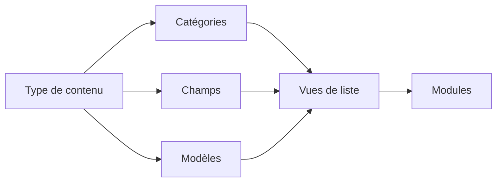

# Introduction à FLEXIcontent

**FLEXIcontent** est un composant Joomla! qui transforme la gestion native des articles en un véritable **CCK** (*Content Construction Kit*). Il ne remplace pas `com_content`, `com_categories` ni `com_tags` : il s'appuie dessus pour ajouter des types de contenu, des champs personnalisés, des règles d'accès, des filtres et des modèles d'affichage.

Cette documentation est maintenue en anglais et en français, et vise la branche **FLEXIcontent 5.x**, compatible avec **Joomla! 4.x, 5.x et 6.x**.

## Ce que permet FLEXIcontent

- Créer un nombre illimité de **types de contenu** : article, événement, fiche produit, annuaire, portfolio, documentation, etc.
- Définir des **champs personnalisés** réutilisables, avec valeurs uniques ou multiples, tris, ACL et historisation.
- Organiser les contenus dans des **catégories imbriquées**, avec affectation à plusieurs catégories.
- Construire des vues de liste avec **recherche et filtres facettés** sur les champs.
- Gérer un **workflow** de publication et des permissions fines via Joomla ACL.
- Personnaliser l'affichage avec des **modèles PHP/CSS** pour les vues article et catégorie.
- Utiliser les **modules** fournis (contenus universels, filtres, carte, nuage de tags, catégories, recherche).
- Importer et exporter des contenus au format **CSV**.

## Comment ça s'articule ?

## Pour qui ?

- **Webmasters et rédacteurs** : créer et publier des contenus structurés sans coder.
- **Intégrateurs et webdesigners** : construire des mises en page sur mesure avec les modèles et les champs.
- **Développeurs** : étendre FLEXIcontent avec ses propres champs, plugins ou scripts, via l'API.

## Où commencer ?

- [Installer FLEXIcontent](./demarrage/installation.md)
- [Suivre le guide « premiers pas »](./demarrage/premiers-pas.md)
- [Découvrir les concepts clés](./concepts/types-de-contenu.md)

:::note
Cette documentation est un projet communautaire indépendant. Pour les informations officielles, consultez le [site de FLEXIcontent](https://www.flexicontent.org/) et sa [documentation officielle](https://flexicontent.org/_documentation_notes/).
:::
